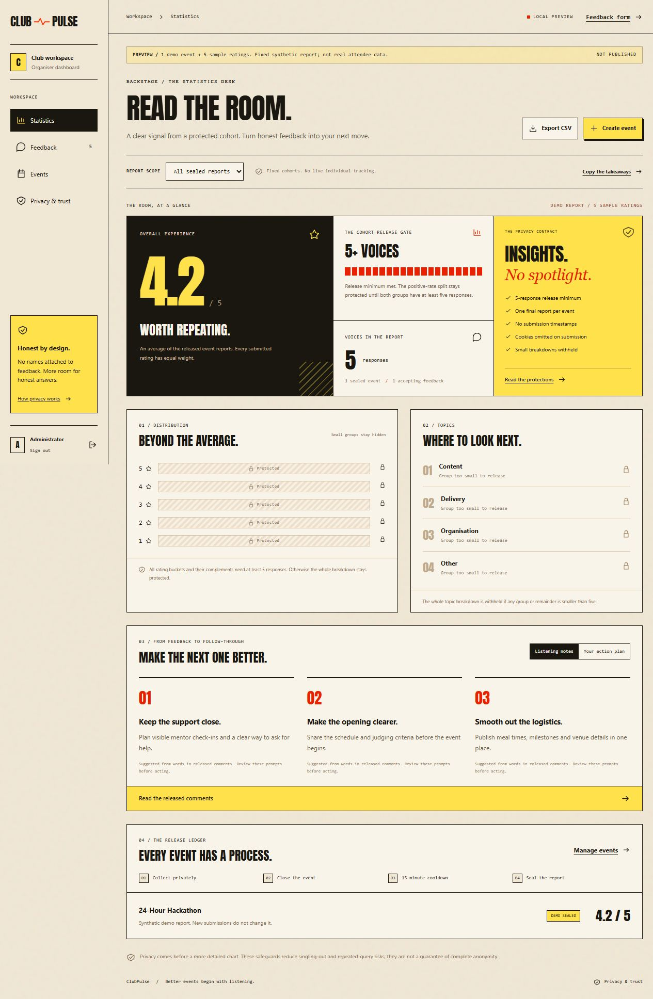

# ClubPulse

Anonymous event feedback built with MongoDB, Express, React and Node. The interface uses paper tones, condensed typography, sharp ticket borders, yellow highlights and red accents. The dashboard turns released feedback into a clear event report and an organiser action plan.



## Review the preview first

No GitHub push or public deployment has been performed. Public launch remains on hold until the custom domain is connected, HTTPS works, the favicon loads, and branding is verified. No paid service or domain has been purchased.

With Node 24 installed:

```powershell
npm ci
npm run dev
```

Open http://localhost:3000. Without a `.env` or database URI, development starts a temporary collector on port 3000 and a temporary issuer on port 3001. These are separate HTTP listeners but share a process and this computer in local preview. This is not infrastructure isolation.

The preview includes one clearly labelled **24-Hour Hackathon**, five synthetic ratings (5, 4, 4, 3, 5), and a frozen demo report: **4.2/5 average, 5 responses**. The positive-rate split stays protected because its groups are too small. Those fixtures are excluded from production and automated tests. New test submissions never change the synthetic report. Small rating and topic cells are deliberately marked **Protected**, not replaced with invented numbers.

### Try it

1. Select the hackathon and **Use demo code**. This fills `HACKATHON-DEMO-2026` locally; it does not send anything yet.
2. Click **Sign in with event code**. The browser sends that code and a blinded random token directly to the issuer on port 3001, without cookies or referrer.
3. The issuer validates the invitation, signs the blinded token and marks the invitation exchanged. The browser unblinds the signature.
4. Rate the event, choose a topic, and optionally comment. The browser sends the signed token and feedback to the collector on port 3000, without the invitation code, cookies or referrer.
5. The demo code can be exchanged once per server restart. Unfinished token exchanges are kept in this tab's session storage for retry. Losing tab storage can lose the token.
6. Open **Administrator sign-in** and enter the local preview credentials: `admin@clubpulse.local` / `local-preview-only`.
7. Review Statistics, Released Comments, Events and Privacy. Generate additional invitation codes under Events. The app does not email attendees or store attendee rosters.

## What changed for anonymity

### Separate issuer and collector

`server/issuer.js` owns event private signing keys and invitation hashes. `server/index.js` is the collector and holds only public keys. The collector has no `/issue` endpoint. Production requires a separate HTTPS issuer origin. Use separate databases, database credentials, hosting access and logs to make the separation meaningful.

The collector authenticates server-to-server event provisioning, invitation generation and event-state changes with `ISSUER_ADMIN_SECRET`. This secret is never returned to browsers. The public issuer endpoint accepts the invitation code and blinded value. It does not accept feedback. The collector accepts feedback and a signed token; it rejects invitation/identity fields, cookies and Authorization headers.

The suite is Cloudflare's RFC 9474 `RSABSSA-SHA384-PSS-Randomized`, with a separate 2048-bit RSA key per event. Signature verification and canonical token hashes prevent forged-token and alternate-Base64 replay attempts. One-use codes prevent code reuse, not a person receiving several codes.

### Sealed event reports

Real reports release only when **all** of these hold:

- The event is closed.
- At least five valid responses exist.
- At least 15 minutes have passed since closure.

Release happens on the first authenticated statistics/export request after eligibility. No cron service is required. Response counts are hidden during collection and cooldown. An event with fewer than five responses remains protected; no exact small count or raw responses are returned.

Reports are persisted once and never updated. Once a real report is sealed, its event cannot reopen. Create a new event for another cohort. Reopening an unpublished event cancels the pending cooldown; closing it starts a new 15-minute cooldown. This prevents using sequential report snapshots to identify a new respondent by subtraction.

Only **whole-event selection** is permitted on reporting APIs. Rating, topic, search and submission-date query slices are rejected. The released-comment search operates locally on text already released to the browser; it does not create a new backend cohort.

### Safe breakdowns and exports

Each rating/topic cell and its complement, and both sides of the positive-rate split, need at least five responses before a cell count is released. If any cell is too small, the entire breakdown is withheld so subtracting visible cells from the total cannot reveal it. Combining reports never reconstructs a suppressed cell. Overall score and response total describe an eligible fixed event cohort. The positive percentage additionally needs at least five positive and five non-positive responses. This is threshold-based disclosure reduction, not differential privacy or a guarantee against inference when an attacker knows other attendees' answers.

Released comments are shuffled once into a stable random order. They carry no rating, topic, row ID or submission time. Free-text comments may still identify their authors. The form warns about identifiers and checks for contact-like text locally, without sending it to a third party. The check cannot detect every identifying detail.

CSV exports contain **sealed event aggregates only**: event, source label, response total, average, positive percentage and report version. They never contain raw comments, invitations, tokens, submission times or small-cell counts.

### Data and logs

Collector feedback records contain a random UUID, event ID, rating, topic, comment and unique token hash. They contain no submission date/time, IP address, user-agent, name, email or invitation code. The event metadata includes an event-level cooldown deadline. A write guard serialises event closure with MongoDB feedback transactions; it is a random value, not a submission timestamp or counter.

Neither service installs access/body logging. Rate limiting uses temporary HMAC-derived network keys in process memory; the secret rotates on restart. The network still processes IP addresses, and hosting providers, proxies, MongoDB operational metadata or external APM tools can reveal timing. Configure logging and retention at those layers. This code cannot disable provider-controlled logs.

Separate services controlled by the same operator do not prevent that operator correlating network traffic. Protect databases and backups: someone with direct database access can read stored feedback. Client-code manipulation, identifying comments and timing remain risks. The application has not had an independent security audit. Use HTTPS and do not claim complete or untraceable anonymity.

References: [RFC 9474](https://www.rfc-editor.org/rfc/rfc9474.html), [Cloudflare blindrsa-ts](https://github.com/cloudflare/blindrsa-ts), [OWASP logging guidance](https://cheatsheetseries.owasp.org/cheatsheets/Logging_Cheat_Sheet.html).

## Dashboard

- Overall-experience score poster and positive-feedback signal.
- Released-cohort count and privacy-contract card.
- Rating/topic landscapes with explicit suppression.
- Listening prompts derived by simple keyword rules from released comments. These are suggestions for organiser review, not sentiment classifications.
- Editable action plan saved only in the organiser's browser, plus copyable report takeaways.
- Release ledger showing collecting, cooldown, protected and released states without exposing unreleased counts.
- Shuffled released comments, event management, invitation downloads and aggregate CSV export.
- Responsive layouts, self-hosted Anton font with its OFL licence, no AI badge, no third-party trackers or remote-font requests.

## Persistent local setup

MongoDB transactions require a replica set, such as an Atlas cluster or a local replica-set configuration. A standalone `mongod` is insufficient for the collector's transaction boundary.

1. Create **two databases**: `clubpulse_collector` and `clubpulse_issuer`.
2. Give each service a different database user with read/write access only to its own database. Do not give the collector access to issuance collections or signing keys.
3. Copy `.env.example` to `.env`; copy `.env.issuer.example` to `.env.issuer`.
4. Fill database URIs, unique admin credentials and random secrets. Use the same `ISSUER_ADMIN_SECRET` on the two services.
5. Generate each secret separately with:

```powershell
node -e "console.log(require('node:crypto').randomBytes(32).toString('hex'))"
```

6. Start the issuer in one terminal:

```powershell
node --env-file=.env.issuer server/issuer.js
```

7. Start the collector/UI in another:

```powershell
npm run dev
```

8. Create a real test event and submit at least five responses with five different invitations. During collection, statistics must show protected results. Close the event, wait 15 minutes, and load its report. Restart both services and confirm the report remains identical and cannot reopen.

This privacy revision uses new `CollectorEventV2` and `CollectorFeedbackV2` models. It does not silently import legacy timestamped records. No production data existed in this checkout. Review any external legacy data and access rules before a migration.

## Tests and production build

```powershell
npm test
npm run build
```

Tests exercise real blind issuance across the two local listeners, credential rejection, forbidden identity fields, forged tokens, replay, unreleased-count protection, cooldown, immutable reports, complementary cell suppression, stripped comment metadata, and aggregate-only exports. The isolated integration process uses an accelerated test-only cooldown. The production cooldown is fixed at 15 minutes. The real MongoDB/Atlas connection and host infrastructure still require verification with your own accounts.

## GitHub, after preview approval

Create an empty `clubpulse` repository on GitHub. Then, in this project folder:

```powershell
git init
git add .
git status
git commit -m "Build privacy-first ClubPulse feedback and sealed reports"
git branch -M main
git remote add origin https://github.com/YOUR_USERNAME/clubpulse.git
git push -u origin main
```

Replace `YOUR_USERNAME`. Confirm no `.env`, `.env.issuer`, invitation downloads, database data or private keys are staged. The example env files are safe templates; all real env variants are ignored.

## Deployment and domain checklist

Do not launch or submit a temporary host address as the final link. No deployment has been made. You need your own accounts, database configuration and custom-domain DNS access. Review provider plan and billing screens before accepting a service. Domain registration can cost money; nothing has been bought here.

1. After source review, connect the GitHub repository to **two Node web services**, one collector and one issuer. Static-only hosting cannot run the backend.
2. Collector build: `npm ci && npm run build`. Start: `npm start`. Set `NODE_ENV=production`, `DEMO_MODE=false`, collector `MONGODB_URI`, `ADMIN_EMAIL`, strong `ADMIN_PASSWORD`, `SESSION_SECRET`, `ISSUER_ADMIN_SECRET`, `ISSUER_URL=https://issuer.YOUR_DOMAIN`, and `PUBLIC_ORIGIN=https://YOUR_DOMAIN`. Health: `/api/health`.
3. Issuer build: `npm ci`. Start: `npm run issuer`. Set `NODE_ENV=production`, `DEMO_MODE=false`, `ISSUER_MONGODB_URI`, the matching `ISSUER_ADMIN_SECRET`, and `PUBLIC_ORIGIN=https://YOUR_DOMAIN`. Health: `/health`. Do not give this service collector database credentials.
4. Use separately scoped DB credentials and separate operator access where feasible. Allow only the hosting outbound ranges into Atlas. The issuer and collector must use different HTTPS origins; ideally use separate hosting accounts/providers and distinct registrable domains if a higher-assurance threat model requires it.
5. Connect custom hostnames in the hosting dashboard, add the exact DNS records it supplies, verify the domains and wait for valid TLS. Never bypass certificate warnings. Disable default host subdomains where supported.
6. Configure host/proxy/APM logging to avoid request bodies, codes, tokens, comments and identifying network metadata where controls exist. Verify provider retention independently. No replay analytics or third-party scripts should be added to the attendee surface.
7. Test from your custom domain: browser developer tools must show cookies/referrer absent from issuance and feedback requests; feedback payload must have no invitation code; collector must have no issuance route; issuer must have no feedback route.
8. Complete a real five-response event, close it, wait the full cooldown, and verify suppression, aggregate export and immutable results across a redeploy. Requests with `rating`, `category`, `search` or `from` filters must fail. Sign-in sessions are in memory and end on restart; use a single collector instance until shared session storage is added.
9. Verify `/favicon.svg`, mobile presentation, no injected AI badge, `demo:false`, and production rejection of preview credentials. Preserve the issuer keys and reports in their correct databases.
10. Only then submit the verified custom-domain URL and GitHub repository URL.

Official hosting references: [Render web services](https://render.com/docs/web-services), [custom domains](https://render.com/docs/custom-domains), [free service limits](https://render.com/docs/free), [Atlas cluster limits](https://www.mongodb.com/docs/atlas/reference/free-shared-limitations/).


## Separate participant and administrator access

- Participant entrance: `/#participant` or the event-specific `/#participant/EVENT_ID` link. Participants authenticate their event entitlement with a one-use invitation code. They do not create an identity account. Successful verification grants only one anonymous feedback submission for that event.
- Administrator entrance: `/#admin/login`. Email/password credentials grant an explicit server-side admin role. The administrator workspace lives under `/#admin/statistics`, `/#admin/feedback`, `/#admin/events` and `/#admin/privacy`. Legacy bookmarks still require authentication.
- Every report, export, event creation/change and invitation-generation API independently requires a valid administrator session. Changing the URL, sending a participant token or claiming an admin role does not grant access. Public event metadata contains no feedback, counts or reports.
- Participant forms have no administrator navigation. Admin credentials are never prefilled. Local demo credentials remain `admin@clubpulse.local` / `local-preview-only`; production rejects demo mode and requires configured real credentials.
- Signing out clears the current admin view and revokes the session on the server. Use a separate browser profile for participant demonstrations on an administrator's computer. Do not share a browser that is still signed in as administrator.
- Before deployment, configure the two HTTPS services, scoped MongoDB databases, production secrets, custom domain and host logging as described above. Local preview is not a production deployment.


## Report studio features

Statistics now includes report-section navigation, count/percentage chart controls, a metric glossary, manual refresh, a downloadable aggregate HTML brief (open it in a browser and print to PDF), and comparison of two real sealed events. Demo reports cannot be comparison baselines. Comparisons describe rounded scores and do not claim statistical significance.

The organiser action board supports adding tasks, responsible roles, due dates, Planned/In progress/Done statuses, progress totals, suggested actions from listening notes, removal with undo and JSON download. It is scoped to the current report selection and saved only in local browser storage, not synced between administrators. Downloaded briefs exclude comments and action notes; action JSON is a separate private organiser file.
